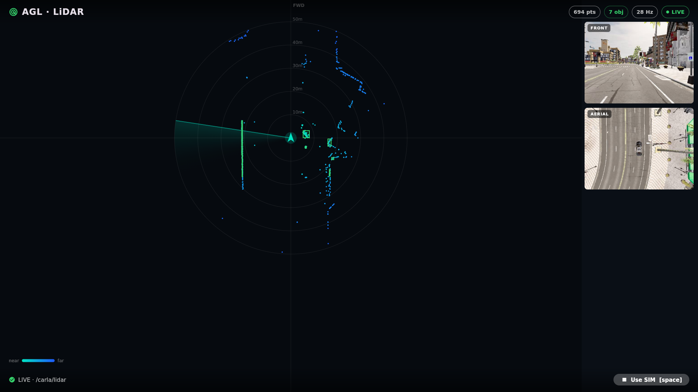
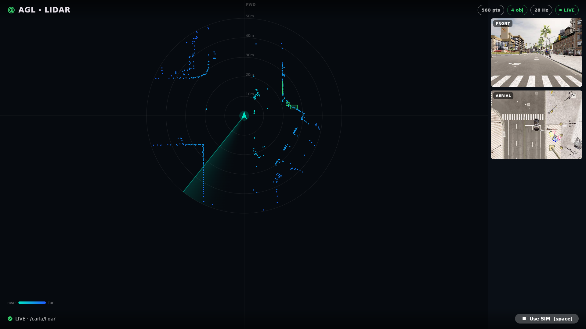

# AGL LiDAR Demo

A Flutter human machine interface (HMI) for Automotive Grade Linux (AGL) that
renders a live top-down LiDAR and perception view. It subscribes to a ROS 2
`sensor_msgs/msg/PointCloud2` stream over a rosbridge WebSocket, draws the point
cloud in real time, overlays the 3D bounding boxes produced by a perception
node, and shows two camera feeds alongside the radar.

The repository ships a recorded CARLA LiDAR clip and a launcher script, so the
whole demo runs fully offline with no live CARLA instance, no GPU, and no
network.



*The dashboard on the Jetson Orin Nano: a top-down LiDAR view with live 3D
detection boxes, plus the forward and aerial camera feeds. The badges show the
point count, objects found, update rate, and link status.*

This application was built for Google Summer of Code 2026 with Automotive Grade
Linux. It is packaged upstream in AGL as `agl-lidar-demo`. See the
[project blog](https://shauryarane05.github.io/agl-gsoc-2026-blog/) and the
[final report](https://shauryarane05.github.io/agl-gsoc-2026-blog/final-report.html)
for the full context.

## Pipeline

```
CARLA LiDAR  ->  /carla/lidar      ->  lidar_detector  ->  /carla/detections  -.
 (recorded       PointCloud2           (PCL clustering)     Detection3DArray    \
  into the                                                                       rosbridge :9090  ->  Flutter HMI
  shipped bag)  ------------------------------------------------------------------ /                    (this app)
```

The point cloud is produced on the target from the raw recording, the detector
turns it into 3D boxes on the same board, and rosbridge carries both to the app.

## The HMI

The app opens one rosbridge connection and subscribes to four topics:

- `/carla/lidar` (`sensor_msgs/msg/PointCloud2`, x/y/z/intensity): the raw cloud,
  drawn as a top-down radar coloured by range.
- `/carla/detections` (`vision_msgs/msg/Detection3DArray`): per-object 3D boxes,
  drawn over the cloud with a live object counter.
- `/carla/hero/rgb_front/image/compressed` and `.../rgb_aerial/...`
  (`sensor_msgs/msg/CompressedImage`): the forward and aerial camera panels.

`/carla/detections` is the perception contract. The classical clustering node
publishes it today, and a learned detector (for example PointPillars) can
publish the same message later, so the HMI does not change when the perception
backend is upgraded.



*Green boxes are the perception node's 3D detections, drawn over the raw point
cloud and computed on the target in real time.*

The view auto-starts in LIVE mode and connects to the local rosbridge. A
built-in simulated mode draws a synthetic scene when no source is connected.
Keyboard: `Space` / `Enter` / `G` toggle between live and simulated, `L` forces
live, `S` forces simulated.

Build-time settings (`--dart-define`):

| Define           | Default                   | Purpose                                 |
| ---------------- | ------------------------- | --------------------------------------- |
| `ROSBRIDGE_URL`  | `ws://127.0.0.1:9090`     | rosbridge endpoint to connect to        |
| `SHOW_CAMERAS`   | `true`                    | show or hide the camera column          |
| `CAM_FRONT_TOPIC`| `/carla/hero/rgb_front/image/compressed` | forward camera topic     |
| `CAM_AERIAL_TOPIC`| `/carla/hero/rgb_aerial/image/compressed` | aerial camera topic     |

## Perception node

`perception/lidar_detector/` is a C++ `ament_cmake` ROS 2 package. It subscribes
to `/carla/lidar` and runs a classic PCL pipeline, `VoxelGrid` downsample ->
`PassThrough` z-crop -> RANSAC ground-plane removal -> Euclidean clustering ->
axis-aligned 3D boxes, publishing `vision_msgs/msg/Detection3DArray` on
`/carla/detections` and CUBE markers on `/carla/detections_markers`. See
[perception/README.md](perception/README.md) for details.

```sh
colcon build --packages-select lidar_detector
. install/setup.bash
ros2 run lidar_detector lidar_detector
```

## Offline demo

`scripts/run-demo-bag.sh` starts a local `rosbridge_server` on port 9090, plays
the bundled clip in a loop, and (by default) runs the `lidar_detector` node so
the detections are computed on the target. Launch the Flutter app and it
connects to the local rosbridge automatically.

```sh
# On the AGL image (installed by the recipe):
agl-lidar-demo.sh

# Or from a checkout, pointing at the bundled bag:
BAG_DIR=./rosbag/carla_lidar ./scripts/run-demo-bag.sh
```

Environment overrides:

| Variable    | Default                                       | Purpose                                            |
| ----------- | --------------------------------------------- | -------------------------------------------------- |
| `DEMO_MODE` | `live`                                        | `live` runs the detector on the raw streams; `replay` plays the clip's pre-recorded detections and runs no detector |
| `BAG_DIR`   | `/usr/share/agl-lidar-demo/rosbag/carla_lidar`| path to the rosbag directory                       |
| `PLAY_RATE` | `1`                                           | playback rate multiplier (the clip is recorded in real time) |

## Development loop

The app is version-matched to the AGL Flutter image so it hot-reloads onto a
running target. Point it at the host rosbridge (for the QEMU target the guest
reaches the host at `10.0.2.2`):

```sh
flutter run -d agl-qemu --dart-define=ROSBRIDGE_URL=ws://10.0.2.2:9090
```

## Repository layout

```
lib/main.dart                         Flutter application
perception/lidar_detector/            PCL clustering node (cloud -> 3D boxes)
rosbag/carla_lidar/                   recorded clip (metadata.yaml, demo_clip_0.db3)
scripts/run-demo-bag.sh               offline launcher (rosbridge + bag + detector)
package/agl_lidar_demo.svg            application icon
```

## Packaging for AGL

The app is packaged for AGL with a BitBake recipe that uses
`inherit flutter-app agl-app`. The recipe installs the Flutter bundle, copies the
clip to `/usr/share/agl-lidar-demo/rosbag`, and installs the launcher as
`/usr/bin/agl-lidar-demo.sh`. Runtime dependencies include `flutter-auto`,
`rosbridge-server`, `ros2bag`, the ROS 2 CLI tools, and the `lidar_detector`
package. The recipe is upstream in AGL as `agl-lidar-demo`
([Gerrit 31990](https://gerrit.automotivelinux.org/gerrit/c/AGL/meta-agl-devel/+/31990)).

## License

Apache-2.0. See [LICENSE](LICENSE).

## Author

Shaurya Rane <ssrane_b23@ee.vjti.ac.in>
